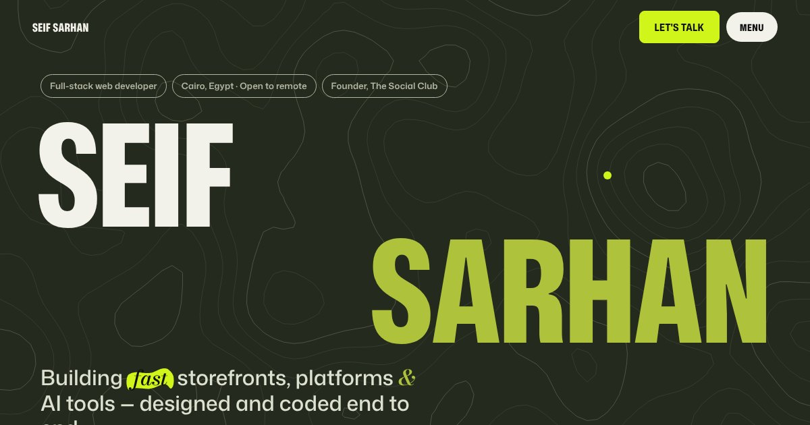

# Seif Sarhan — Portfolio

My developer portfolio, live at **https://seifsarhan.github.io**



- A topographic contour map drawn by hand in JavaScript (no libraries). Its contour lines drift, move with the page as you scroll and rise into a hill under your cursor
- An F1 starting-lights intro, a pinned side-scrolling project grid that leans with your scroll speed, and statement text that lights up word by word
- Project filters, a details view for each project, a work and education timeline, a certificates section with verify links, and a downloadable CV
- Self-hosted fonts (Mona Sans and Bodoni Moda), no build step, works on phones and respects `prefers-reduced-motion`

## Edit it

Everything you'd change lives in [`js/data.js`](js/data.js):

- `CONFIG`: name, contact details, CV path, agency link
- `PROJECTS`: one entry per project. Put its screenshot at `assets/projects/<id>.webp`
- `JOURNEY`, `EDUCATION`, `CERTS`, `SKILLS`: the timeline, certificates and toolbox

## Run locally

```bash
npx serve .
```
